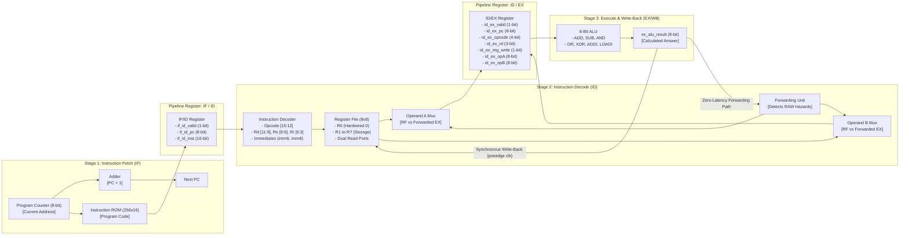

# Architecture Specification: 3-Stage Pipelined 8-Bit Processor

**Document:** `docs/architecture.md`  
**Project:** ADIC_8BIT_PROCESSOR  
**Target Architecture:** 3-Stage Pipelined 8-Bit RISC Microarchitecture  
**HDL Standard:** Verilog-2001 (IEEE 1364-2001)  
**Target Toolchain:** Xilinx Vivado (Vivado XSim Simulator & RTL Synthesis)  

---

## 1. Introduction for Beginners: What is a Pipelined Processor?

To understand this project, imagine doing laundry with three steps:
1. **Wash** clothes in the washer.
2. **Dry** clothes in the dryer.
3. **Fold** clothes on the table.

- **Non-Pipelined Approach:** You put load 1 in the washer, wait for it to finish, put it in the dryer, wait for it to finish, and fold it. Only then do you start load 2. Each load takes 3 hours, and the dryer and washer sit empty most of the time!
- **Pipelined Approach:** While load 1 is drying, load 2 goes into the washer! While load 1 is being folded, load 2 is drying, and load 3 is in the washer. Once the pipeline is full, **one clean load of laundry finishes every single hour!**

In our processor, every instruction goes through **three stages**:
1. **Instruction Fetch (IF):** Grab the instruction from memory.
2. **Instruction Decode (ID):** Read what the instruction wants to do and fetch numbers from the registers.
3. **Execute & Write-Back (EX/WB):** Do the math in the ALU and save the answer back into the register.

In steady-state operation, **three instructions are processed simultaneously**, achieving a throughput of **1 instruction per clock cycle** ($\text{CPI} = 1.0$).

---

## 2. Three-Stage Pipeline Architecture



---

### 2.1 Stage 1: Instruction Fetch (IF)
- **Program Counter (PC):** An 8-bit register holding the address of the current instruction (from `8'h00` to `8'hFF`, allowing 256 instruction memory words).
- **PC Incrementer:** A dedicated 8-bit adder computing `pc + 8'd1` every clock cycle.
- **Instruction Memory (ROM):** A 256 $\times$ 16-bit memory holding our machine code. Reading is combinational/asynchronous: feeding `pc` immediately presents the 16-bit instruction word on `rom_inst`.
- **IF/ID Pipeline Register:**
  - `if_id_valid`: Indicates whether this stage holds a valid instruction (`1`) or a reset bubble (`0`).
  - `if_id_pc`: The 8-bit PC of the fetched instruction.
  - `if_id_inst`: The 16-bit instruction word passed to Stage 2.

---

### 2.2 Stage 2: Instruction Decode & Register Read (ID)
- **Bitfield Deconstruction:** Splits the 16-bit instruction into:
  - Opcode (`inst[15:12]`): 4-bit operation selector.
  - Destination Register `Rd` (`inst[11:9]`): Which register will receive the result.
  - Source Register 1 `Rs` (`inst[8:6]`): First input register.
  - Source Register 2 `Rt` (`inst[5:3]`): Second input register.
  - Immediate `imm6` (`inst[5:0]`): 6-bit signed constant for `ADDI`.
  - Immediate `imm8` (`inst[7:0]`): 8-bit constant for `LOADI`.
- **Control Unit:** Combinational logic generating:
  - `id_reg_write`: Asserted (`1`) if the instruction updates a register.
  - `id_uses_rs`: Asserted (`1`) if the instruction reads register `Rs`.
  - `id_uses_rt`: Asserted (`1`) if the instruction reads register `Rt`.
- **Register File (8 $\times$ 8-bit):**
  - Eight registers: R0, R1, R2, R3, R4, R5, R6, R7.
  - **R0 Hardwire Rule:** In computer architecture, register R0 is conventionally fixed to zero. In our design, reads from address `3'b000` always return `8'h00`. Any instruction attempting to write to R0 is ignored (`waddr != 3'b000`).
  - **Dual Read Ports:** `rdata1` and `rdata2` can be read simultaneously in the same cycle.
  - **Internal Write-Through Bypass:** If an instruction writes to a register at the exact same cycle another instruction reads it, the new write data is bypassed directly to the read output, preventing simulation timing ambiguities.
- **Operand Forwarding Unit (EX/WB $\rightarrow$ ID):** Described in Section 3.
- **ID/EX Pipeline Register:** Latches control signals, register addresses, and prepared operands `opA` and `opB` into Stage 3 on the next rising clock edge.

---

### 2.3 Stage 3: Execute & Write-Back (EX/WB)
- **Arithmetic Logic Unit (ALU):** Fully combinational 8-bit execution unit supporting:
  - Arithmetic: `ADD` ($A + B$), `SUB` ($A - B$), `ADDI` ($A + \text{sign\_ext}(imm6)$)
  - Bitwise Logic: `AND` ($A \land B$), `OR` ($A \lor B$), `XOR` ($A \oplus B$)
  - Immediate Transfer: `LOADI` (passes $imm8$ directly to output)
- **Register Write-Back:** The calculated `ex_alu_result` connects to the write port of the Register File. On the rising clock edge closing Stage 3, the value is committed into `R[Rd]`.

---

## 3. Data Hazard Resolution & Forwarding Priority

### 3.1 What is a Read-After-Write (RAW) Hazard?
Consider two consecutive instructions:
```text
Inst 1: LOADI R1, 5       (Calculates R1 = 5 in EX/WB)
Inst 2: ADDI  R2, R1, 3   (Needs R1 in ID to calculate R2)
```

In Cycle 3:
- `Inst 1` is in **EX/WB**, computing `5`.
- `Inst 2` is in **ID**, reading `R1` from the Register File.
- **The Problem:** `Inst 1` has not written `5` to the Register File yet! The Register File will only receive `5` at the end of Cycle 3. If `Inst 2` reads the physical Register File, it gets the old stale value `0`!

### 3.2 The Forwarding Solution
Because the ALU in Stage 3 calculates its result combinationally, the correct value (`5`) is already sitting on the internal wires `ex_alu_result` during Cycle 3!
The **Forwarding Unit** compares the destination register of Stage 3 (`id_ex_rd`) with the source registers of Stage 2 (`id_rs`, `id_rt`):

$$\text{fwd\_a} = \text{if\_id\_valid} \land \text{id\_ex\_valid} \land \text{id\_ex\_reg\_write} \land (\text{id\_ex\_rd} \neq 0) \land \text{id\_uses\_rs} \land (\text{id\_rs} == \text{id\_ex\_rd})$$

$$\text{fwd\_b} = \text{if\_id\_valid} \land \text{id\_ex\_valid} \land \text{id\_ex\_reg_write} \land (\text{id\_ex\_rd} \neq 0) \land \text{id\_uses\_rt} \land (\text{id\_rt} == \text{id\_ex\_rd})$$

- When `fwd_a` is high, `opA_mux` grabs `ex_alu_result` directly instead of the stale Register File output!
- When `fwd_b` is high, `opB_mux` grabs `ex_alu_result` directly.
- **Forwarding Priority:** Because forwarding takes place directly from the immediate predecessor in EX/WB, it takes precedence over the Register File. If `id_ex_rd == id_rs`, the forwarded value overrides the register file output.
- **Zero Stall Cycles:** With this forwarding mechanism, back-to-back arithmetic instructions execute with **zero delay bubbles** and **zero pipeline stalls**!

---

## 4. Pipeline Timing Table

The table below demonstrates how instructions advance through the 3 pipeline stages cycle-by-cycle:

| Cycle | Stage 1: Fetch (IF) | Stage 2: Decode (ID) | Stage 3: Execute / Write-Back (EX/WB) | Active Forwarding | Register Committed |
| :---: | :--- | :--- | :--- | :---: | :---: |
| **1** | Inst 0 (`LOADI R1, 5`) | *Bubble* (`valid=0`) | *Bubble* (`valid=0`) | None | None |
| **2** | Inst 1 (`ADDI R2, R1, 3`) | Inst 0 (`LOADI R1, 5`) | *Bubble* (`valid=0`) | None | None |
| **3** | Inst 2 (`ADD R3, R1, R2`) | Inst 1 (`ADDI R2, R1, 3`) | Inst 0 (`LOADI R1, 5`) | **FwdA (R1 from EX)** | **R1 $\Leftarrow$ 5** |
| **4** | Inst 3 (`SUB R4, R3, R1`) | Inst 2 (`ADD R3, R1, R2`) | Inst 1 (`ADDI R2, R1, 3`) | **FwdB (R2 from EX)** | **R2 $\Leftarrow$ 8** |
| **5** | Inst 4 (`AND R5, R3, R2`) | Inst 3 (`SUB R4, R3, R1`) | Inst 2 (`ADD R3, R1, R2`) | **FwdA (R3 from EX)** | **R3 $\Leftarrow$ 13** |
| **6** | Inst 5 (`OR R6, R1, R2`) | Inst 4 (`AND R5, R3, R2`) | Inst 3 (`SUB R4, R3, R1`) | None (reads RF) | **R4 $\Leftarrow$ 8** |
| **7** | Inst 6 (`XOR R7, R3, R2`) | Inst 5 (`OR R6, R1, R2`) | Inst 4 (`AND R5, R3, R2`) | None (reads RF) | **R5 $\Leftarrow$ 8** |
| **8** | Inst 7 (`LOADI R0, 255`) | Inst 6 (`XOR R7, R3, R2`) | Inst 5 (`OR R6, R1, R2`) | None (reads RF) | **R6 $\Leftarrow$ 13** |
| **9** | Inst 8 (`ILLEGAL_OP`) | Inst 7 (`LOADI R0, 255`) | Inst 6 (`XOR R7, R3, R2`) | None | **R7 $\Leftarrow$ 5** |
| **10**| Inst 9 (`NOP`) | Inst 8 (`ILLEGAL_OP`) | Inst 7 (`LOADI R0, 255`) | None | **R0 write blocked!** |
| **11**| Inst 10 (`NOP`) | Inst 9 (`NOP`) | Inst 8 (`ILLEGAL_OP`) | None | **No write (illegal op)** |
| **12**| Inst 11 (`NOP`) | Inst 10 (`NOP`) | Inst 9 (`NOP`) | None | None (Drained) |

---

## 5. Synchronous Active-High Reset

- **Reset Signal (`rst`):** Synchronous active-high. This means state transitions only take place on the rising edge of the clock when `rst == 1'b1`.
- **Reset State:**
  - `pc <= 8'h00`
  - `if_id_valid <= 1'b0`
  - `if_id_inst <= 16'h0000` (NOP)
  - `id_ex_valid <= 1'b0`
  - `id_ex_reg_write <= 1'b0`
  - Registers `R1` through `R7` cleared to `8'h00`
- **Reset Release:** When `rst` drops to `0`, the processor begins fetching instruction 0 at `pc = 0x00` on the very next rising clock edge.

---

## 6. Architectural Design Trade-Offs

1. **3-Stage Pipeline vs. 5-Stage Pipeline (Classic MIPS):**
   - *5-Stage (IF, ID, EX, MEM, WB):* Splits execution and write-back, and adds data memory stages. This requires complex 2-level forwarding paths (EX $\rightarrow$ EX and MEM $\rightarrow$ EX) and introduces load-use stall bubbles.
   - *Our 3-Stage Design (IF, ID, EX/WB):* Merging Execute and Write-Back into Stage 3 eliminates memory latency for arithmetic workloads, simplifies forwarding to a single EX/WB $\rightarrow$ ID path, and achieves 1.0 CPI with zero stall cycles.
2. **Forwarding to ID vs. Forwarding to EX ALU Inputs:**
   - In a 3-stage pipeline, forwarding directly into the ID stage multiplexers allows the ID/EX pipeline register to latch already-forwarded operands. This keeps the EX stage combinational delay short, maximizing achievable clock frequency ($F_{max}$).
3. **Hardwired R0 vs. 8 General-Purpose Registers:**
   - Dedicating R0 as a constant zero register simplifies clear/move operations and provides a standard RISC zero reference at the cost of one general-purpose storage location.

