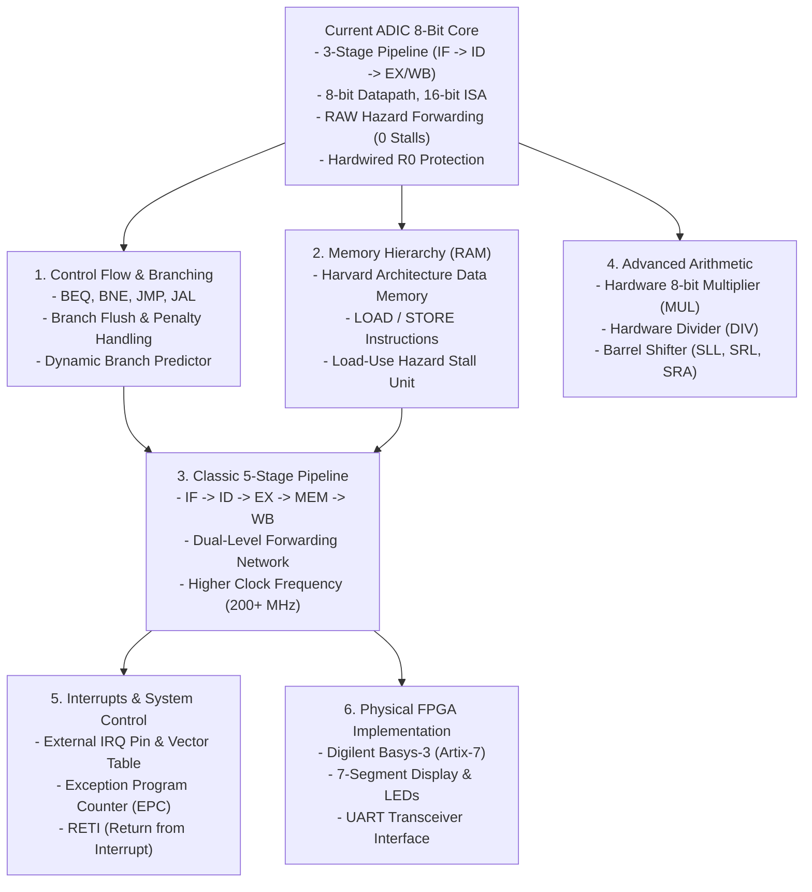

# Future Scope & Technical Roadmap

**Project:** ADIC_8BIT_PROCESSOR  
**Document:** `docs/future_scope.md`  
**Discipline:** Digital Hardware Architecture & Future Microarchitecture Extensions  

---

## 1. Overview

The 3-stage pipelined 8-bit RISC processor developed in this project establishes a rock-solid, synthesizable foundation for digital hardware engineering education. This document details the technical roadmap for extending the processor's microarchitecture, instruction set, hazard handling mechanisms, and physical hardware deployment.

---

## 2. Technical Roadmap & Milestone Extensions

---

## 3. Detailed Extension Specifications

### 3.1 Control Flow & Branching Architecture
Currently, the processor executes instructions sequentially ($\text{PC} \leftarrow \text{PC} + 1$). The first high-priority extension is adding branching and jumping:

1. **Conditional Branches (`BEQ`, `BNE`):**
   - Format: Compare registers $Rs$ and $Rt$. If condition holds, $\text{PC} \leftarrow \text{PC} + \text{offset}$.
   - **Control Hazard:** Because branch decisions are resolved in Stage 3 (EX), the two instructions fetched behind the branch must be flushed if the branch is taken.
   - **Flushing Mechanism:** Introduce a synchronous `pipeline_flush` signal that clears `if_id_valid` and `id_ex_valid` to `0`, transforming speculative instructions into safe NOP bubbles.

2. **Unconditional Jumps & Subroutines (`JMP`, `JAL`):**
   - `JMP target`: Directly sets $\text{PC} \leftarrow \text{target}$.
   - `JAL target`: Jump and Link; stores the return address ($\text{PC} + 1$) into register R7 and jumps to subroutine `target`.
   - `RET`: Return from subroutine; loads $\text{PC} \leftarrow R[7]$.

---

### 3.2 Memory Hierarchy & Load/Store Architecture
Currently, all operands reside in registers or immediate fields. Adding a dedicated **Data RAM** transforms the processor into a complete load/store architecture:

1. **Instructions:**
   - `LOAD Rd, [Rs + imm]`: Reads 8-bit data from RAM at address $Rs + imm$ into register $Rd$.
   - `STORE Rt, [Rs + imm]`: Writes 8-bit data from register $Rt$ into RAM at address $Rs + imm$.

2. **The "Load-Use" Hazard Challenge:**
   - In ALU-to-ALU operations, results are available at the end of the EX stage, so forwarding resolves hazards in **0 stall cycles**.
   - With `LOAD`, data is read from RAM and is **not available** until the end of the memory cycle!
   - **Hardware Stall Unit:** A Hazard Detection Unit (HDU) must compare `id_ex_mem_read` with `id_rs` and `id_rt`. When a load-use collision occurs:
     1. Freeze the Program Counter: `pc_stall = 1`.
     2. Freeze the IF/ID pipeline register: `if_id_stall = 1`.
     3. Insert a single bubble into the ID/EX register: `id_ex_flush = 1`.
     4. Data is forwarded on the subsequent cycle with only a single clock penalty!

---

### 3.3 Migration to Classic 5-Stage RISC Pipeline
To achieve higher operating frequencies, the current 3-stage pipeline can be decoupled into the industry-standard 5-stage RISC microarchitecture:

$$\text{Stage 1: IF} \longrightarrow \text{Stage 2: ID} \longrightarrow \text{Stage 3: EX} \longrightarrow \text{Stage 4: MEM} \longrightarrow \text{Stage 5: WB}$$

**Benefits:**
- **Shorter Critical Paths:** Decoupling ALU computation from Register File write-back halves the stage propagation delay, enabling clock speeds exceeding **200 MHz** on 28nm FPGA fabrics.
- **Dual-Level Forwarding:** The Forwarding Unit will monitor two producer stages: `EX/MEM` (distance-1 hazard) and `MEM/WB` (distance-2 hazard), selecting the newest result with strict producer priority.

---

### 3.4 Hardware Multiplier & Barrel Shifter
1. **8-Bit Hardware Multiplier (`MUL`):**
   - Implement an unsigned/signed array multiplier or Wallace Tree generating a 16-bit product stored across high and low register pairs (e.g., $R3:R2$).
2. **Combinational Barrel Shifter:**
   - Support variable single-cycle bit shifts:
     - `SLL Rd, Rs, imm3` (Shift Left Logical).
     - `SRL Rd, Rs, imm3` (Shift Right Logical).
     - `SRA Rd, Rs, imm3` (Shift Right Arithmetic with sign replication).

---

### 3.5 Physical FPGA Implementation (Digilent Basys-3 / Artix-7)
The current RTL is 100% synthesizable Verilog-2001 and is completely prepared for physical hardware targeting:

1. **Target Board:** Digilent Basys-3 FPGA (Xilinx Artix-7 XC7A35T-1CPG236C).
2. **Peripherals Integration:**
   - **Clock Management:** On-board 100 MHz oscillator divided down to 1 Hz or manual step button for educational visual stepping.
   - **Seven-Segment Display:** Multiplexed driver showing current PC and selected register contents in hexadecimal.
   - **LED Status Indicators:** 8 LEDs displaying `ex_alu_result`, with individual LEDs indicating `fwd_a`, `fwd_b`, and `rst`.
   - **UART Communication Module:** Serial transmitter sending register dump frames to a PC terminal at 115,200 baud on program completion.

